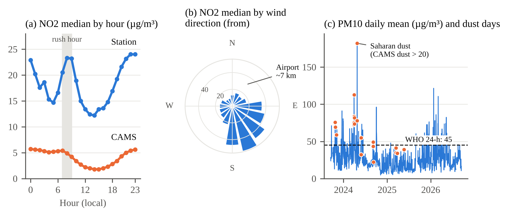

# Localised Next-Day Air Quality Forecasting for Arnavutköy, Istanbul

**MTH4800 Innovation Campus AI Applications — Capstone Project, Group 9**

Harun Bazancir · Ata Ali Sarımaden · Ömer Malik Sönmez · Khadıja Huseynova · Aykut Coşkun

---

## Overview

Air pollution is one of the most important environmental health risks in large cities. This project builds a machine-learning tool that forecasts **tomorrow's daily concentrations of PM10, PM2.5, SO2 and NO2** at the Arnavutköy (Istanbul) monitoring station by **correcting the Copernicus (CAMS) air-quality forecast with local measurements and weather**, and compares the forecast with the **WHO 24-hour guideline levels**.

- **SDG link:** SDG 11.6 — urban air quality (indicator 11.6.2) — primary; SDG 3.9 — illness and death from air pollution (indicator 3.9.1) — secondary [1, 7]
- **Target users:** residents of Arnavutköy/Istanbul and sensitive groups (children, older adults, people with respiratory or heart conditions), and local decision-makers
- **Final product (planned):** a Streamlit web app with tomorrow's forecast, a WHO-based alert, dust and wind context, historical trends and an explanation of each forecast
- **Project proposal:** [updated after feedback](docs/updated_bazancir_sarimaden_sonmez_huseynova_coskun.pdf) · [original submission](docs/bazancir_sarimaden_sonmez_huseynova_coskun.pdf) (its flowchart: [`docs/flowchart_v1.png`](docs/flowchart_v1.png))

## What changed after feedback (Assignment 1, revised)

The instructor's feedback was that the model only saw the station's own history and needed outside data to become original. In response:

| Feedback | What we did | Where |
|---|---|---|
| Add weather data (Open-Meteo) | Hourly wind speed/direction, temperature, humidity, precipitation, pressure, gusts for the station point | [`03_external_data`](notebooks/03_external_data.ipynb) |
| Use CAMS forecasts, incl. Saharan dust | CAMS European forecast (~11 km) for PM10, PM2.5, NO2, SO2 and dust | [`03_external_data`](notebooks/03_external_data.ipynb) |
| Correct CAMS instead of forecasting from scratch | Ridge models that correct CAMS with station data and weather; compared with persistence **and** raw CAMS | [`05_cams_correction`](notebooks/05_cams_correction.ipynb) |
| Localise: airport, wind direction | Wind-sector analysis by speed class and season | [`04_external_eda`](notebooks/04_external_eda.ipynb) |
| Study Saharan dust days | Dust-event analysis with CAMS dust | [`04_external_eda`](notebooks/04_external_eda.ipynb) |
| *Planned (A2):* neighbouring stations, İBB traffic density, Sentinel-5P NO2 | — | Roadmap |

Two data issues were also resolved along the way: SİM timestamps end in `:00:56` and are now floored to the hour before merging, and the **time zone is verified** (station–CAMS correlation peaks at a 0-hour shift).

## Key findings

**1. CAMS follows the day-to-day changes but underestimates local levels.** Daily means, study period:

| Pollutant | Station mean (µg/m³) | CAMS mean | CAMS / station | Correlation (r) |
|---|---:|---:|---:|---:|
| PM10 | 27.3 | 16.5 | 0.61 | 0.70 |
| PM2.5 | 14.9 | 11.2 | 0.75 | 0.55 |
| SO2 | 5.6 | 5.4 | 0.98 | 0.27 |
| NO2 | 24.3 | 7.9 | 0.32 | 0.63 |

CAMS also misses the 07–09 rush-hour NO2 peak, which is the local signal the station adds.

**2. The airport sector brings the cleanest air.** Wind blows from N–NE (towards Istanbul Airport, ~7 km at 32°) in 50% of hours, with a median NO2 of 14.8 µg/m³. Winds from ESE–S (the adjacent multi-lane road and the urban area) occur in 11% of hours but bring 46.7 µg/m³ NO2 and about twice the PM10. The pattern holds in every season and wind-speed class.

**3. Saharan dust drives PM10 episodes.** On the 20 days (10 episodes, mostly March–May) with a CAMS daily dust mean above 20 µg/m³, median PM10 is 64 vs. 23 µg/m³, the PM2.5/PM10 ratio drops from 0.61 to 0.44, and 65% of days exceed the WHO PM10 guideline (other days: 11.5%).



## Forecasting results (validation period, 07.07–17.12.2025)

Target: next day's daily median per pollutant. Chronological split unchanged from the first submission; **the test period (from 18.12.2025) is still unused.** Alpha is chosen by 5-fold `TimeSeriesSplit` within the training period. All models are evaluated on the same days.

| Model (MAE, µg/m³) | PM10 | PM2.5 | SO2 | NO2 |
|---|---:|---:|---:|---:|
| Persistence ("tomorrow = today") | 7.62 | 2.23 | **1.39** | 9.89 |
| Raw CAMS forecast | 8.72 | 3.26 | 5.20 | 13.14 |
| CAMS with linear bias correction only | 8.14 | 7.00 | 5.32 | 7.88 |
| E1: Ridge, station + weather + today's CAMS | 7.12 | 2.44 | 1.58 | 8.68 |
| **E2: Ridge, station + weather + CAMS for tomorrow** | **5.04** | **1.96** | 1.65 | **5.48** |
| Days evaluated (of 164) | 144 | 147 | 111 | 129 |

- E2 reduces MAE by **34% (PM10), 12% (PM2.5) and 45% (NO2)** compared with persistence and by 40–58% compared with raw CAMS. It is the best model in four to five of the six validation months; the largest gains come in autumn and winter.
- E1 uses only information available at the end of today and beats persistence for PM10 and NO2.
- No model beats persistence for SO2, which is low and never exceeds the WHO guideline.
- The CAMS-only bias correction fails for PM2.5 because the station's PM2.5 level dropped in the validation period while CAMS did not; models that also use the latest station value adapt.
- Using each pollutant's own history raised the evaluated days from 48–49 to 111–147.

<details>
<summary>First submission (A1): Ridge with 28 lag features</summary>

| Pollutant | Baseline MAE | Ridge MAE |
|---|---:|---:|
| PM10 | **7.57** | 7.67 |
| PM2.5 | **2.63** | 3.40 |
| SO2 | **1.19** | 1.51 |
| NO2 | **9.58** | 11.42 |

Ridge did not beat the baseline for any pollutant; only 48–49 of the 164 validation days could be evaluated because all 28 inputs had to be present. These numbers are reproduced exactly in [`05_cams_correction`](notebooks/05_cams_correction.ipynb).
</details>

### WHO 2021 24-hour guideline levels [1]

| Pollutant | PM2.5 | PM10 | NO2 | SO2 |
|---|---:|---:|---:|---:|
| Guideline (µg/m³, 24-hour mean) | 15 | 45 | 25 | 40 |
| Valid days above the guideline at Arnavutköy | 36% | 13% | 36% | 0% |

## Data

| Source | Content | File |
|---|---|---|
| Ministry SİM portal [6] | İstanbul – Arnavutköy station (operated by İBB), 41.2209° N, 28.7075° E; hourly PM10, PM2.5, SO2, NO2; 16.09.2023–16.09.2026 (26,305 hours) | [`data/arnavutkoy_hourly_2023-09-16_2026-09-16.xlsx`](data/) |
| Open-Meteo Historical Weather API (ERA5-based) [9, 10] | Hourly weather at the station point | [`data/processed/`](data/processed/) |
| Open-Meteo Air Quality API — CAMS European forecast [8, 9] | Hourly PM10, PM2.5, NO2, SO2, dust at the station point | [`data/processed/`](data/processed/) |

See [`data/README.md`](data/README.md) for column descriptions.

## Methodology


## Limitations

- **CAMS lead time:** the Open-Meteo archive stores the most recent forecast for each hour, so the "tomorrow" CAMS value in E2 has a shorter lead time than a forecast available today. E2 is therefore optimistic and E1 is the conservative bound. A2 will re-evaluate with genuine day-ahead CAMS runs from the Copernicus Atmosphere Data Store.
- **Weather:** ERA5 is observed (reanalysis) weather, so only today's weather is used as input.
- **Single station:** results cannot be generalised to all of Istanbul.
- **Data quality:** `985` readings and hours with PM2.5 > PM10 could not be confirmed as sensor errors without device information; the PM2.5 level shift in the validation period needs checking with the operator.

## Roadmap

- **Assignment 2:** genuine day-ahead CAMS evaluation; Random Forest and XGBoost; walk-forward validation; neighbouring stations (e.g. Başakşehir, Sultangazi); İBB traffic density for NO2; a simple end-to-end Streamlit tool.
- **Assignment 3:** final model with one check on the held-out test period, Streamlit app with WHO-based alerts, dust and wind context and SHAP explanations, Docker container and cloud deployment; Sentinel-5P NO2 (GIS week).

## Repository structure

```
├── data/
│   ├── arnavutkoy_hourly_2023-09-16_2026-09-16.xlsx   raw station data
│   └── processed/                                      station + weather + CAMS, hourly and daily
├── docs/        flowchart, figures, proposals (original and updated)
├── notebooks/   Colab notebooks 01–05
└── requirements.txt
```

## Notebooks

| Notebook | Content | Open |
|---|---|---|
| [`01_eda`](notebooks/01_eda.ipynb) | Cleaning, quality control and exploratory data analysis | [Colab](https://colab.research.google.com/github/maliksonmez/arnavutkoy-air-quality-forecast/blob/main/notebooks/01_eda.ipynb) |
| [`02_forecast_baseline_ridge`](notebooks/02_forecast_baseline_ridge.ipynb) | First experiment: baseline vs. Ridge with 28 lags | [Colab](https://colab.research.google.com/github/maliksonmez/arnavutkoy-air-quality-forecast/blob/main/notebooks/02_forecast_baseline_ridge.ipynb) |
| [`03_external_data`](notebooks/03_external_data.ipynb) | Downloads weather and CAMS from Open-Meteo, merges with station data, builds `data/processed/` | [Colab](https://colab.research.google.com/github/maliksonmez/arnavutkoy-air-quality-forecast/blob/main/notebooks/03_external_data.ipynb) |
| [`04_external_eda`](notebooks/04_external_eda.ipynb) | CAMS vs. station, time-zone check, wind sectors and airport, Saharan dust | [Colab](https://colab.research.google.com/github/maliksonmez/arnavutkoy-air-quality-forecast/blob/main/notebooks/04_external_eda.ipynb) |
| [`05_cams_correction`](notebooks/05_cams_correction.ipynb) | CAMS correction experiment (E1, E2) vs. persistence and raw CAMS | [Colab](https://colab.research.google.com/github/maliksonmez/arnavutkoy-air-quality-forecast/blob/main/notebooks/05_cams_correction.ipynb) |

## How to run

Open a notebook in Google Colab with the links above and choose *Runtime → Run all*. Notebooks 03–05 read their data directly from this repository; no upload or API key is needed. Notebooks 01–02 ask you to upload the raw Excel file from `data/`.

## References

1. World Health Organization (2021). *WHO global air quality guidelines: particulate matter (PM2.5 and PM10), ozone, nitrogen dioxide, sulfur dioxide and carbon monoxide.* Geneva: WHO. https://iris.who.int/handle/10665/345329
2. Jalali, M. W., Saidi, B., Farahmand, H., Rezvan Panah, M. A., & Saruhan, E. N. (2025). Scalable AI-driven air quality forecasting and classification for public health applications. *Discover Atmosphere, 3*, 25. https://doi.org/10.1007/s44292-025-00052-8
3. Yavuz, E., Balkanlı, N. G. N., Saral, A., & Kuzu, S. L. High-resolution CFD modelling of traffic-related air pollutant dispersion in an urban area of Istanbul, Türkiye.
4. Kuzu, S. L., Yavuz, E., Akyüz, E., Saral, A., Akkoyunlu, B. O., Özdemir, H., Demir, G., & Ünal, A. Black carbon and size-segregated elemental carbon, organic carbon compositions in a megacity: a case study for Istanbul. *Air Quality, Atmosphere & Health.*
5. Kuzu, S. L., & Saral, A. (2017). The effect of meteorological conditions on aerosol size distribution in Istanbul. *Air Quality, Atmosphere & Health, 10*(8), 1029–1038.
6. Republic of Türkiye Ministry of Environment, Urbanisation and Climate Change, Continuous Monitoring Centre (SİM). Station data download, İstanbul–Arnavutköy, 16.09.2023–16.09.2026 (accessed 16 October 2026). https://sim.csb.gov.tr/STN/STN_Report/StationDataDownloadNew
7. World Health Organization. Air quality, energy and health — SDG indicators 3.9.1 and 11.6.2. https://www.who.int/teams/environment-climate-change-and-health/air-quality-energy-and-health/policy-progress/sustainable-development-goals-air-pollution
8. Copernicus Atmosphere Monitoring Service (CAMS). CAMS European air quality forecasts. Atmosphere Data Store. https://ads.atmosphere.copernicus.eu/datasets/cams-europe-air-quality-forecasts
9. Open-Meteo. Air Quality API and Historical Weather API (CC BY 4.0). https://open-meteo.com
10. Hersbach, H., Bell, B., Berrisford, P., et al. (2020). The ERA5 global reanalysis. *Quarterly Journal of the Royal Meteorological Society, 146*(730), 1999–2049. https://doi.org/10.1002/qj.3803

*Data attribution: contains modified Copernicus Atmosphere Monitoring Service information; weather and air-quality data via Open-Meteo (CC BY 4.0).*
