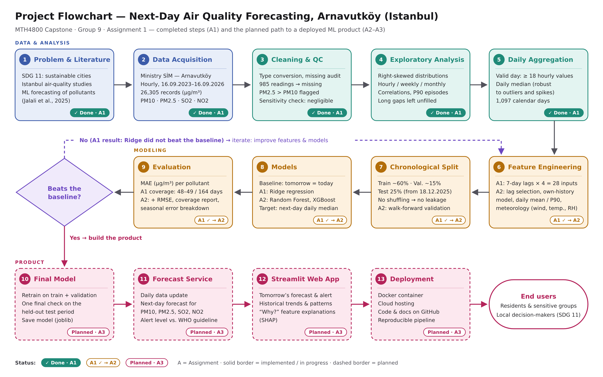

# Next-Day Air Quality Forecasting for Arnavutköy, Istanbul

**MTH4800 Innovation Campus AI Applications — Capstone Project, Group 9**

Harun Bazancir · Ata Ali Sarımaden · Ömer Malik Sönmez · Khadıja Huseynova · Aykut Coşkun

---

## Overview

Air pollution is one of the most important environmental health risks in large cities. This project builds a machine-learning tool that forecasts **tomorrow's daily concentrations of PM10, PM2.5, SO2 and NO2** at the Arnavutköy (Istanbul) air quality monitoring station, and compares them with the **WHO 24-hour air quality guideline levels**.

- **SDG link:** SDG 11.6 — reduce the environmental impact of cities, with special attention to air quality (indicator 11.6.2) — primary; SDG 3.9 — reduce illnesses and deaths from air pollution (indicator 3.9.1) — secondary [1, 7]
- **Target users:** residents of Arnavutköy/Istanbul and sensitive groups (children, the elderly, people with respiratory or heart conditions), and local decision-makers
- **Final product (planned):** a Streamlit web app showing tomorrow's forecast, an alert level, historical trends and an explanation of each forecast

### WHO 2021 24-hour guideline levels [1]

| Pollutant | PM2.5 | PM10 | NO2 | SO2 |
|---|---:|---:|---:|---:|
| Guideline (µg/m³, 24-hour mean) | 15 | 45 | 25 | 40 |
| Valid days above the guideline at Arnavutköy | 36% | 13% | 36% | 0% |

Air pollution is a frequent problem at this station: the daily mean exceeded the WHO guideline on about a third of valid days for PM2.5 and NO2. Studies in Istanbul show that traffic is a dominant urban source [3], that black carbon follows NO2 with rush-hour peaks [4], and that meteorology strongly affects particle levels [5].

## Data

| | |
|---|---|
| Source | Ministry of Environment, Urbanisation and Climate Change — SİM station data download ([sim.csb.gov.tr](https://sim.csb.gov.tr/STN/STN_Report/StationDataDownloadNew)) [6] |
| Station | İstanbul – Arnavutköy |
| Period | 16.09.2023 – 16.09.2026 (hourly) |
| Records | 26,305 hourly rows · 1,097 calendar days |
| Pollutants | PM10, PM2.5, SO2, NO2 (µg/m³) |

The raw data file is included in [`data/`](data/) exactly as downloaded (publicly available on the SİM portal). See [`data/README.md`](data/README.md) for details.

## Methodology



1. **Cleaning and quality control.** Text-to-number conversion and missing-value audit (3.9–5.8% missing per pollutant). Seven suspicious `985` readings are set to missing in the analysis copy; the raw data is kept unchanged. A sensitivity check shows that this choice has a negligible effect on the results.
2. **Exploratory data analysis.** Distributions, hourly/weekly/monthly patterns, correlations and high-pollution episodes.
3. **Daily aggregation.** A day is valid if it has at least 18 hourly readings. The daily **median** is used because it is robust to single-hour spikes and suspicious values.
4. **Forecasting (Assignment 1 — first experiment).**
   - Target: next day's daily median for each pollutant
   - Inputs: the previous 7 days of all 4 pollutants (28 lag features)
   - Chronological split: ~60% training · ~15% validation · 25% test (test period not used yet; no shuffling, to avoid leakage)
   - Models: **baseline** ("tomorrow = today") vs. **Ridge regression**, following the baseline-first approach in [2]
   - Metric: **MAE** (mean absolute error, µg/m³)

## Assignment 1 results (validation period, 07.07–17.12.2025)

| Pollutant | Baseline MAE | Ridge MAE |
|---|---:|---:|
| PM10 | **7.57** | 7.67 |
| PM2.5 | **2.63** | 3.40 |
| SO2 | **1.19** | 1.51 |
| NO2 | **9.58** | 11.42 |

In this first experiment, Ridge regression did not beat the simple baseline for any pollutant. Only 48–49 of the 164 validation days could be evaluated, because the model required all 28 inputs to be available.

## Limitations

- Single station: results cannot be generalised to all of Istanbul.
- No meteorological variables (wind, temperature, humidity) yet.
- The time zone of the source data has not been verified.
- `985` readings and hours with PM2.5 > PM10 could not be confirmed as sensor errors without device information.

## Roadmap

- **Assignment 2:** improve the model — lag selection, one model per pollutant using its own history, filling short gaps, additional daily summaries (mean, P90), meteorological data, walk-forward validation, Random Forest and XGBoost.
- **Assignment 3:** final model, Streamlit web app with alerts based on WHO guideline levels and SHAP explanations, Docker container and cloud deployment.

## Repository structure

```
├── data/        raw hourly data (Excel) and data notes
├── docs/        flowchart, proposal and presentation
├── notebooks/   Colab notebooks (EDA, forecasting)
└── requirements.txt
```

## Notebooks

| Notebook | Content | Open |
|---|---|---|
| [`notebooks/01_eda.ipynb`](notebooks/01_eda.ipynb) | Cleaning, quality control and exploratory data analysis | [Open in Colab](https://colab.research.google.com/github/maliksonmez/arnavutkoy-air-quality-forecast/blob/main/notebooks/01_eda.ipynb) |
| [`notebooks/02_forecast_baseline_ridge.ipynb`](notebooks/02_forecast_baseline_ridge.ipynb) | Daily aggregation, lag features, baseline vs. Ridge | [Open in Colab](https://colab.research.google.com/github/maliksonmez/arnavutkoy-air-quality-forecast/blob/main/notebooks/02_forecast_baseline_ridge.ipynb) |

## How to run

Open a notebook in Google Colab with the links above, run the cells in order, and upload `data/arnavutkoy_hourly_2023-09-16_2026-09-16.xlsx` when the notebook asks for it.

## References

1. World Health Organization (2021). *WHO global air quality guidelines: particulate matter (PM2.5 and PM10), ozone, nitrogen dioxide, sulfur dioxide and carbon monoxide.* Geneva: WHO. https://iris.who.int/handle/10665/345329
2. Jalali, M. W., Saidi, B., Farahmand, H., Rezvan Panah, M. A., & Saruhan, E. N. (2025). Scalable AI-driven air quality forecasting and classification for public health applications. *Discover Atmosphere, 3*, 25. https://doi.org/10.1007/s44292-025-00052-8
3. Yavuz, E., Balkanlı, N. G. N., Saral, A., & Kuzu, S. L. High-resolution CFD modelling of traffic-related air pollutant dispersion in an urban area of Istanbul, Türkiye.
4. Kuzu, S. L., Yavuz, E., Akyüz, E., Saral, A., Akkoyunlu, B. O., Özdemir, H., Demir, G., & Ünal, A. Black carbon and size-segregated elemental carbon, organic carbon compositions in a megacity: a case study for Istanbul. *Air Quality, Atmosphere & Health.*
5. Kuzu, S. L., & Saral, A. (2017). The effect of meteorological conditions on aerosol size distribution in Istanbul. *Air Quality, Atmosphere & Health, 10*(8), 1029–1038.
6. Republic of Türkiye Ministry of Environment, Urbanisation and Climate Change, Continuous Monitoring Centre (SİM). Station data download, İstanbul–Arnavutköy, 16.09.2023–16.09.2026 (accessed 16 October 2026). https://sim.csb.gov.tr/STN/STN_Report/StationDataDownloadNew
7. World Health Organization. Air quality, energy and health — SDG indicators 3.9.1 and 11.6.2. https://www.who.int/teams/environment-climate-change-and-health/air-quality-energy-and-health/policy-progress/sustainable-development-goals-air-pollution
